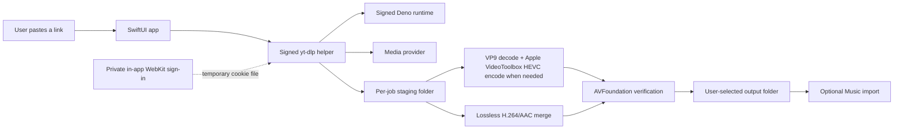

# Architecture

## Runtime boundary

Eucrante is one native Mac application. It has no backend and opens no listening port.

No cookies, source links, job manifests, or media files are sent to Eucrante-operated infrastructure. The provider necessarily receives its normal media request from the user's Mac. Eucrante never reads another browser's files.

## Resource efficiency

Video and audio tracks use yt-dlp's comma-separated format selection in one invocation, sharing provider extraction and JavaScript challenge work. Tracks remain separate until the existing Apple merge/transcode stage. Preview output projects only displayed metadata and format fields; signed URLs, fragment lists, and unrelated provider data stay inside the helper. Repeated readiness checks for the same preview reuse its pending task or current result until the input/session is invalidated.

Downloader progress is emitted at most four times per second between completion events. Each running job has one consumer with a one-element buffer, and same-phase UI updates are throttled. Durable transitions, attempt identity, and terminal completion remain authoritative. Unchanged history rows skip redraws; file availability is checked off the main actor when rows appear, their output changes, or the app returns to the foreground.

Artwork downloads stream through a private ephemeral URLSession, reject oversized response headers, and cancel when the body exceeds 10 MiB. ImageIO downsamples to a maximum 2048-pixel edge before JPEG encoding at 90% quality, avoiding a full-resolution TIFF copy. Both provider artwork and Music import share this bounded download path. Media quality presets are unchanged.

Compatible media copies use APFS cloning when available, with normal copies on other filesystems. Acquisition files are removed after merge or verified HEVC conversion, before final processing, and only inside their owning job directory. Original external inputs are preserved.

History uses compact sorted JSON, retains synchronous atomic writes, and skips identical snapshots. A bounded file-revision/digest cache avoids decoding our own unchanged store before each save; external inode, size, modification-time, or change-time changes force validation again. Corrupt stores still receive private recovery copies and future schemas remain read-only. No history retention limit or automatic deletion of finished media is introduced.

The website remains Workers Static Assets with no application backend or added browser JavaScript. `npm run build` generates `dist/site`, fingerprints resources, and gives only `/static/*` immutable browser caching. HTML retains Cloudflare's default revalidation so new asset names are discovered after deployments. See [measured checks and limits](PERFORMANCE.md).

## Components

| Component | Responsibility |
| --- | --- |
| SwiftUI app | URL entry, presets, settings, consent, queue/history, user feedback |
| `AppModel` | Application composition, settings, macOS actions, and provider-session coordination |
| `DownloadQueue` | FIFO scheduling, concurrency, pause/resume, attempt identity, cancellation, recovery, and durable state transitions |
| `DownloadPipeline` | Acquisition, temporary credentials, metadata, merge/transcode, and verified publication |
| `LinkPreviewModel` | Debouncing, cancellation, stale-result suppression, and private preview workspaces |
| `DownloadWorkspace` | UUID staging paths, artwork roots, and recovery of transient credential exports |
| `LocalMediaAcquirer` | Builds argument arrays, starts helpers without a shell, streams bounded output independently of termination, parses progress, performs bounded parallel readiness checks, handles escalation-tested cancellation, and discovers output |
| `yt-dlp` | Provider extraction and media transfer |
| Deno | Local JavaScript runtime required by current YouTube extraction |
| In-app WebKit session | Optional per-website sign-in stored in Eucrante's private app data, independent of external browsers |
| Minimal FFmpeg helper | Native VP9 decode and Apple VideoToolbox HEVC encode for 1440p/4K; no network, GPL, non-free, x264, or x265 components |
| `AppleVideoTranscoder` | Builds argument arrays, reports progress, cancels the helper, copies AAC, and uses Apple VideoToolbox with software fallback when required |
| `LocalMediaProcessor` | AVFoundation inspection, lossless video/audio merge, Apple conversion, and post-output verification |
| `JobStore` | Lock-serialized, synchronous atomic JSON persistence in Application Support, with protected recovery copies before unreadable data is replaced |

## Trust boundaries

- Source URLs, titles, provider responses, media bytes, metadata, and filenames are untrusted.
- Untrusted values are passed to `Process` as individual arguments. Eucrante never builds a shell command.
- Helper paths are discovered only from the signed app resource directory, the development build directory, or explicit developer environment overrides.
- Authenticated access is disabled by default. The user signs in within Eucrante; no external browser data is read.
- Applicable cookies are exported only for the requested website; simultaneous scan workers use isolated copies. The opaque job folder is mode `0700`; the file is created mode `0600` before any credential bytes are written and is deleted on both success and failure before staging data can be retained. Startup and Sign Out purge remaining exports.
- Each job writes only into an opaque UUID staging directory. Remote titles are sanitized before becoming output filenames.
- Helper environment variables are allowlisted; HOME, XDG config/cache, Deno cache, and temporary paths are redirected into that private job directory.
- A job completes only after AVFoundation opens the output and confirms non-empty usable media.

## Queue invariants

- Submit persists the request before clearing the link or starting a worker. Preferences and destination bookmarks belong to the job, not to mutable application settings.
- Waiting jobs start FIFO. Pausing stops scheduling; it does not cancel active work. Public links run without a login gate. An actual authentication failure pauses affected website jobs, persists a typed error, and prompts a site-specific reconnect. Done rechecks previews and picker rows and retries only authentication-failed jobs. Saved cookies do not imply verified access.
- Each running attempt has its own token. Progress is accepted only for that attempt and in forward phase order. Cancelling jobs continue occupying their slot until the worker exits.
- Success is committed when a verified file is moved into its final filename. No cancellable work follows publication, so a completed move is always reported as a retained file.
- The processor stages output beside the destination, verifies playable tracks and duration, then moves it without overwriting an existing name. Error and cancellation paths remove that attempt's temporary output.
- All per-job and preview storage is derived from the injected history store directory. Tests and the Debug UI preview use disposable roots and independent sessions.
- History v1 is read once when v2 does not yet exist. The first write creates `jobs-v2.json`, preserving `jobs-v1.json` for rollback. Unknown future versions are read-only to this app.

## Acquisition policy

For video through 1080p, Eucrante chooses H.264 MP4 plus AAC/M4A and merges without re-encoding. For 1440p and above, where YouTube normally exposes separate VP9 video, Eucrante downloads VP9 plus AAC, decodes VP9 locally, and encodes HEVC through Apple VideoToolbox, using hardware when available and Apple's software fallback otherwise. The output is tagged `hvc1` in MP4 for Apple playback, while AAC is copied without another lossy encode.

The current path is verified for 4K SDR. HDR preservation is not yet claimed and remains gated on licensed HDR/color fixtures. AV1 input is not selected on Macs without a verified software AV1 decoder; VP9 is preferred with H.264 fallback.

## Release integrity

Helper versions and SHA-256 hashes are pinned in `Scripts/install-local-tools.sh` and `Scripts/build-ffmpeg.sh`. The build fails on a hash mismatch. FFmpeg is built from verified official source as LGPL 2.1-or-later with GPL/non-free/network functionality disabled. Nested executables use Hardened Runtime and are signed before the outer app is signed and notarized. Deno receives only the JIT entitlement required by V8. The self-contained yt-dlp executable receives the library-validation exception required to load its PyInstaller-extracted, separately signed Python framework. The bundle audit launches both under their final signatures; FFmpeg and the app receive neither exception. Updating a helper requires a reviewed version/hash change, license review, tests, and a changelog entry.

`Scripts/verify-app.sh` audits the assembled bundle rather than trusting build success: expected tools and licenses must exist, identifiers and minimum system version must match, all executables must verify under code signing, every helper must support the app architecture, the app icon must be present, and FFmpeg must retain its pinned restricted configuration. Native checks run locally on macOS and enforce strict formatting, app/core tests, script/plist validation, and ratcheted line-coverage floors for both targets. Cloudflare's Linux build validates and deploys only the static project website.

Release packaging has two intentionally separate trust levels. The public-preview path permits only a clean exactly tagged, ad-hoc-signed app and emits an architecture-labelled `-unnotarized.dmg`, checksum, and provenance that records the missing notarization; its publisher forces prerelease status and fixed Open Anyway guidance. The stable path permits only Developer ID signing, submits and staples the app, creates a drag-to-Applications DMG and portable ZIP, separately signs/notarizes/staples the DMG, passes Gatekeeper, and records accepted notarization. Automatic updates remain disabled until a separately reviewed signed-feed trust model exists.

## Page scanning

`PagePickerModel` owns scan generations, cancellation, stable row order, and a bounded two-minute in-memory result cache (30 seconds for failures). Sixteen worker lanes run batches of at most eight links, grouped by website so credentials never cross site boundaries. Each batch uses one full yt-dlp extraction process and reuses its player/extractor setup. Results stream as soon as formats are available. Exact YouTube error prefixes identify their failed video; unattributed batch failures get an individual probe so one item's login error is never assigned to other sources. Resource directories are removed only after all processes and cookie exports have stopped. Account changes invalidate that site's cached results.
