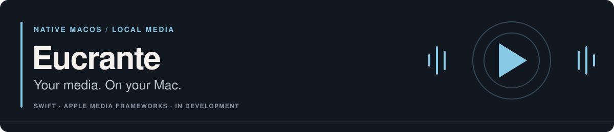

<p>
  
</p>

Eucrante is a native macOS app for saving media locally, preparing Apple-compatible audio and video, and importing audio into Music. Paste a link, choose an output, and save it to your Mac.

[Build](#build) · [Features](#current-product) · [How it works](#how-it-works) · [Website](https://chai-in.github.io/Eucrante/) · [Contribute](CONTRIBUTING.md)

> **In development — build from source.** There are no tagged releases or public binary downloads yet. Requires **macOS 14+**, **full Xcode**, and the **Swift 6 toolchain**.

## Current product

| Task | What Eucrante provides |
| :--- | :--- |
| Choose an output | Music — Best, Music — Efficient, Video — Best, Video — Efficient, and Custom, with codec, quality, and exact or estimated size previews. |
| Save audio for Music | Provider metadata and artwork, optional manual edits, and explicit Music import that preserves the downloaded audio. |
| Prepare video for Apple devices | H.264/AAC merging through 1080p; local VP9-to-HEVC conversion for 1440p and 4K SDR, with Apple hardware acceleration when available. |
| Manage ongoing work | Local queue and history, progress, cancellation, retry, and a custom output folder. |
| Find the result | Open the file, reveal it in Finder, move it to Trash, or import audio into Music. Completed files are inspected before success is reported. |

YouTube sign-in happens inside Eucrante's own private browser session. The app does not read another browser's cookies. Premium formats depend on what the provider makes available; membership does not guarantee a distinct format for every video.

Eucrante does not bypass DRM or access controls. Save only media you own or are permitted to download, following the provider's terms. HDR preservation and AV1 input are not currently claimed. See the [output policies](Docs/PRESETS.md) and [YouTube boundary](Docs/YOUTUBE-PREMIUM.md).

## Build

On a Mac with the requirements above:

```sh
git clone https://github.com/chai-in/Eucrante.git
cd Eucrante
make app
```

The app bundle is written to `dist/Eucrante.app`. The build targets the build Mac's architecture and verifies that every bundled helper supports it.

The first build downloads checksum-pinned helpers and builds the minimal FFmpeg helper from source, so it needs internet access. Helpers and their license notices are embedded in the app; users of the resulting bundle do not need to install them separately.

## Install

**Source builds are the current starting point.** [GitHub Releases](https://github.com/chai-in/Eucrante/releases) will carry public previews when they are available.

The public-preview packaging path produces ad-hoc-signed, **unnotarized** DMGs, explicitly named `*-unnotarized.dmg`, with matching checksum and provenance files. These are distinct from the Developer ID-signed and notarized stable-release path.

For a future preview, verify its checksum and source before opening it. If macOS blocks a build you chose to trust, use **System Settings → Privacy & Security → Open Anyway** after the initial launch attempt. Do not disable Gatekeeper or remove quarantine attributes. See the [release guide](Docs/RELEASING.md) for the full distribution and verification process. Homebrew Cask support is deferred until notarized distribution is available.

## How it works

1. **Preview:** the native SwiftUI interface probes the link locally and shows available outputs and metadata.
2. **Acquire:** bundled `yt-dlp` and Deno helpers fetch media directly from the provider.
3. **Prepare:** compatible streams are merged without re-encoding. Higher-resolution VP9 video is converted locally to HEVC using a minimal LGPL FFmpeg build and Apple's VideoToolbox.
4. **Verify and save:** AVFoundation inspects the finished media before it reaches the chosen output folder. Music import is a separate, explicit action.

Processing and job history stay on the Mac. There is no Eucrante account or hosted processing service, and no analytics or advertising SDK. Providers receive the requests needed to fetch their media. See [privacy](PRIVACY.md) and the [architecture](Docs/ARCHITECTURE.md) for the boundaries.

### Why the local design?

Eucrante began with a native Mac interface and a hosted backend. It was rebuilt around a single local runtime so the everyday workflow would not depend on setting up infrastructure or another computer. The [architecture decisions](Docs/DECISIONS.md) explain the current design; the [commit history](https://github.com/chai-in/Eucrante/commits/main/) records its evolution.

## Development

Run the native checks on macOS:

```sh
swift test -Xswiftc -warnings-as-errors
./Scripts/check-coverage.sh 92 83
swift run EucranteCoreChecks
make app
```

<details>
<summary>Optional live-media checks</summary>

Use a media fixture you are authorized to download:

```sh
EUCRANTE_E2E_URL='https://www.youtube.com/watch?v=…' \
swift run EucranteCoreChecks
```

Add `EUCRANTE_E2E_4K=1` for the VP9-to-HEVC 4K path. Developers may supply a temporary Netscape cookie file through `EUCRANTE_E2E_COOKIE_FILE`. Never commit cookies or private media. The shipping app creates a restricted temporary export from its own WebKit session and deletes it after acquisition.

</details>

The [contribution guide](CONTRIBUTING.md) covers formatting, builds, and review expectations. Native app checks require macOS and Xcode; the static website has separate portable build checks.

## Architecture and product notes

| For | Read |
| :--- | :--- |
| Product behavior | [Product contract](Docs/PRODUCT.md) · [Presets](Docs/PRESETS.md) · [Roadmap](Docs/ROADMAP.md) |
| Implementation | [Architecture](Docs/ARCHITECTURE.md) · [Decisions](Docs/DECISIONS.md) · [UI system](Docs/UI-SYSTEM.md) |
| Distribution | [Releasing](Docs/RELEASING.md) · [Repository notes](Docs/REPOSITORY.md) · [Changelog](CHANGELOG.md) |
| Help and reports | [Support](SUPPORT.md) · [Security policy](SECURITY.md) · [Privacy](PRIVACY.md) |

## License

Original Eucrante code and documentation are licensed under [Apache License 2.0](LICENSE). Bundled helpers retain their own licenses; see [third-party notices](THIRD_PARTY_NOTICES.md). Eucrante uses the work of the yt-dlp, Deno, and FFmpeg projects alongside Apple frameworks.
